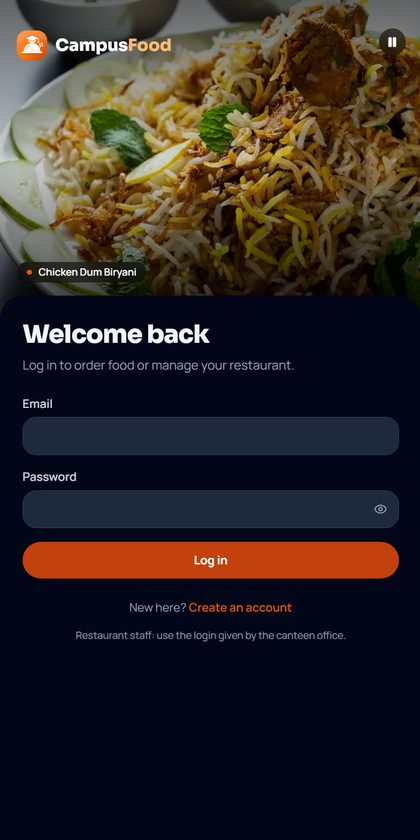
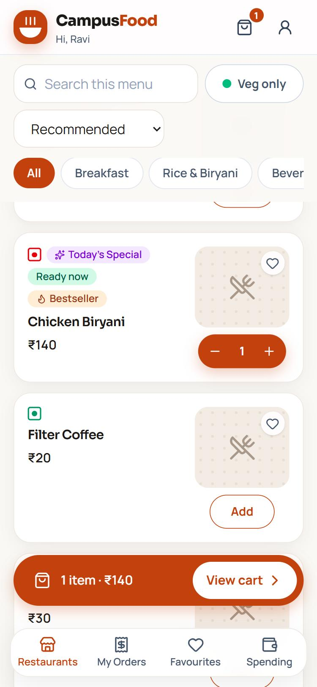
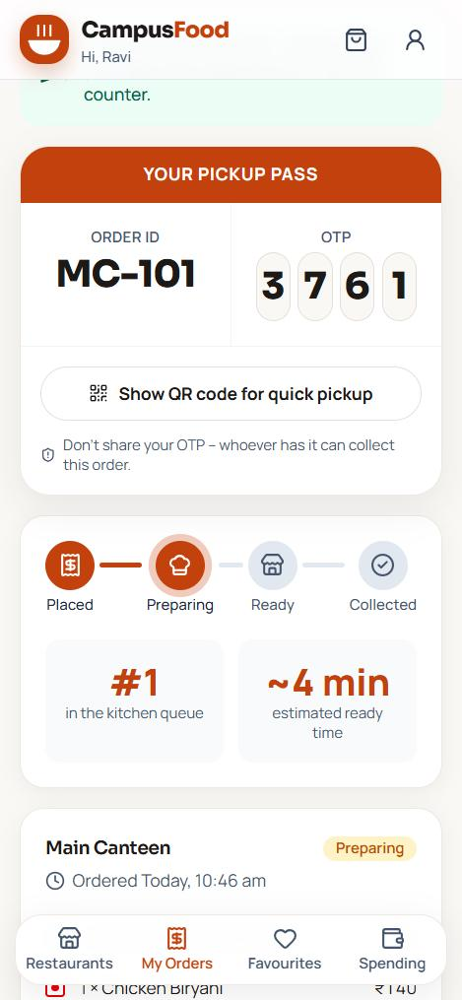
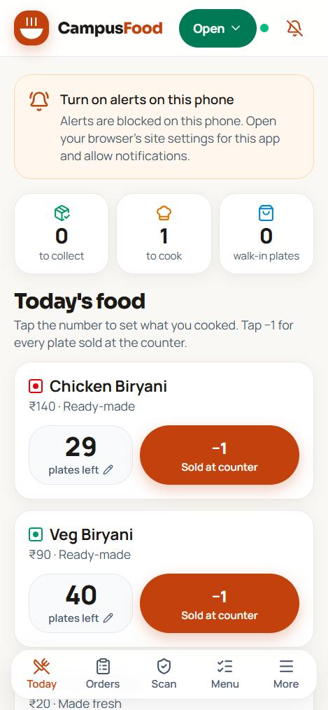
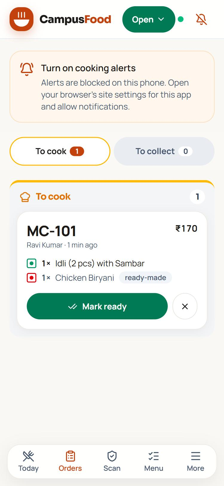
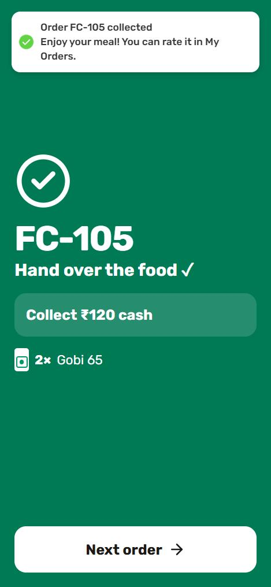
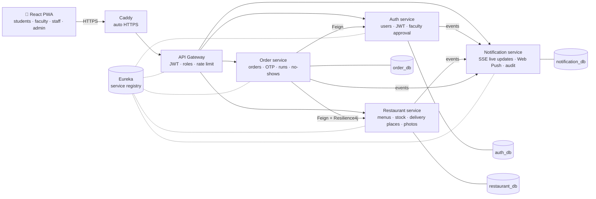

<div align="center">


# Campus Food — Pre-Order System

**Order ahead. Skip the queue.** A food pre-ordering platform for college canteens: students order from their phone,
canteens cook in batches and hand over food with an Order ID + OTP, and faculty get food delivered to their room.

[](https://campusfoods.duckdns.org)


</div>

> **Live in a real trial** with a campus canteen — built and run on a **₹0 budget** (free and open-source tools only).
> The live site serves real orders, so please don't place test orders there; run it locally instead (see [Run it locally](#run-it-locally)).

<p align="center">
  
  
  
</p>
<p align="center">
  
  
  
</p>

## The problem

Campus canteens run on a **paper notebook and phone calls**. At lunch, students queue for 20+ minutes, owners lose
orders in the noise, and faculty often can't leave class to collect food at all. The owners are too busy cooking to
tap a screen for every order — so a solution has to take work *off* them, not add more.

## What it does

| For | Features |
|---|---|
| **Students** | Browse today's menu of every canteen · pre-order for a time slot · live queue position and ETA · pickup pass with Order ID, 4-digit OTP and QR code · alerts on the phone when food is ready (even when locked) · favourites, spending history, ratings |
| **Faculty** | Verified with a college-ID photo, approved by the admin · **delivery to their room** on fixed delivery runs · delivery fee & minimum order set by each canteen · OTP handover at the door |
| **Canteen owners** | Batch-cooking mode for biryani (plates counted down automatically, one tap for a walk-in sale) · live order board · scan QR or type OTP to hand over · **Deliveries** screen grouped by run and building · open/busy/closed switch · auto-open with yesterday's menu and an evening cash summary · works when the internet drops (handovers are saved and synced later) · photo upload from the phone |
| **Admin** | Dashboard and charts · canteens, menus and logins · all orders with CSV export · faculty approvals · user blocking · announcements · audit log |

## Engineering highlights

- **Microservices done properly** — 6 Spring Boot 4.1 services (Java 21) with **Eureka** discovery and a **Spring Cloud
  Gateway** that validates JWTs, enforces role rules and rate-limits per user / IP. Services reject any request that
  didn't come through the gateway (shared key), and service-to-service calls carry a separate internal key.
- **Resilient service calls** — OpenFeign + **Resilience4j** circuit breakers and time limits; business errors from
  another service are passed through, outages turn into a clear "try again" instead of a hanging spinner.
- **Correct under the lunch rush** — order placement is a mini **saga** (reserve plates → save order → give the plates
  back if saving fails), **idempotency keys** stop double orders on flaky Wi-Fi, and **optimistic locking** plus
  conditional status updates stop two staff phones from handing over the same order twice.
- **Real-time without polling** — **Server-Sent Events** push live order updates to every open screen.
- **Push notifications from scratch** — Web Push encryption (**RFC 8291**, aes128gcm) and **VAPID** (RFC 8292)
  implemented with plain JDK crypto, verified against the RFC test vector; push endpoints are allow-listed against SSRF.
- **Offline-first counter phone** — the last order list stays visible without internet, and OTP handovers typed offline
  are queued and replayed safely when the connection returns.
- **Background jobs** — no-show detection with a per-canteen hold time (plates go back on sale), stale-order clean-up,
  morning auto-open and an evening cash summary pushed to the owner.
- **Safe file uploads** — photos are shrunk on the phone; the server checks the real file type from its first bytes and
  stores it under a random name. College-ID photos live in a **private** volume, are visible only to the admin, and are
  deleted as soon as the request is decided.
- **Faculty delivery** — fulfilment type (pickup / delivery), delivery places, scheduled runs with order cut-offs,
  run-based dispatch and a missed-delivery fallback to counter pickup.
- **Production on a ₹0 budget** — Docker Compose on a cloud VM, **Caddy** for automatic HTTPS, DuckDNS, nightly
  database + photo backups, a one-click deploy script and a written server-migration runbook.
- **Tested** — unit tests (Web Push crypto, daily routines) and end-to-end API test scripts covering ordering, handover,
  stock, no-shows and the full faculty-delivery flow.

## Architecture



| Service | Port | Database | Responsibility |
|---|---|---|---|
| eureka-server | 8761 | – | Service registry |
| api-gateway | 8080 | – | Single entry point: routing, JWT validation, CORS, rate limiting |
| auth-service | 8081 | auth_db | Register and login, JWT, roles, blocking, faculty verification |
| restaurant-service | 8082 | restaurant_db | Canteens, menus, daily stock, open/busy/closed, favourites, delivery places & settings, photos |
| order-service | 8083 | order_db | Orders, pre-order slots, OTP/QR handover, queue position, delivery runs, no-shows |
| notification-service | 8084 | notification_db | Live updates (SSE), Web Push, announcements, audit log |

The browser only talks to the gateway. In development, Vite proxies `/api/*` to `localhost:8080`. Each database is
created automatically on first start.

## Tech stack

| Layer | Technology |
|---|---|
| Backend | Java 21, Spring Boot 4.1, Spring Cloud Gateway, Eureka, OpenFeign, Resilience4j, Spring Data JPA, MySQL 8, JWT, springdoc OpenAPI |
| Frontend | React 19, Vite, Tailwind CSS v4, React Router, vite-plugin-pwa (Workbox), Lucide icons |
| Infrastructure | Docker Compose, Caddy (automatic HTTPS), DuckDNS, cloud VM (Azure), cron backups |

## Run it locally

**Requirements:** JDK 21 · Node.js 20+ · MySQL 8 on `localhost:3306` · Python 3 (only for the seed and test scripts)

```bat
build-all.bat          :: builds the 6 JARs and runs npm install (add "test" to also run the unit tests)
start-all.bat          :: asks for the MySQL password, then starts everything in separate windows
start-all.bat scale    :: also starts a 2nd Order Service on 8093 to show load balancing
python scripts\seed_demo.py      :: once, on a fresh database: demo canteens, dishes and logins
```

Give the services about a minute to register, then open http://localhost:5173 (phones on the same Wi-Fi:
`http://<this-PC-IP>:5173`) and the Eureka dashboard at http://localhost:8761.

**Demo logins** (created by `seed_demo.py` — local only, change them before real use):

| Role | Email | Password |
|---|---|---|
| Student | student@campusfood.test | student123 |
| Main Canteen (MC) | maincanteen@campusfood.test | canteen123 |
| Food Court (FC) | foodcourt@campusfood.test | canteen123 |
| Admin (at `/admin-2406`) | admin@campusfood.local | Admin@123 |

End-to-end API test against the running system: `python scripts\e2e_api_test.py`

**API docs (Swagger):** Auth http://localhost:8081/swagger-ui.html · Restaurant :8082 · Order :8083 · Notification :8084

## Deploying (free)

One cloud VM runs everything with Docker Compose; Caddy serves the website and gets the HTTPS certificate for a free
DuckDNS address. See [docs/DEPLOY-ORACLE.md](docs/DEPLOY-ORACLE.md). After the first deploy, website changes go live
with `scripts\deploy-frontend.bat`, and `scripts\download-backups.bat` copies the nightly backups to a laptop.

## Configuration

Every secret has a development default in `application.yml`. **In production, set every variable below** (see
`.env.example`).

| Variable | Used by | Purpose |
|---|---|---|
| `DB_HOST`, `DB_PORT` | auth, restaurant, order, notification | MySQL location (defaults: `localhost`, `3306`) |
| `DB_USERNAME`, `DB_PASSWORD` | same | MySQL login. Use a dedicated user, not root. |
| `JWT_SECRET` | gateway, auth | Signs login tokens. Use a long random string. |
| `GATEWAY_KEY` | all services | Proves a request came through the gateway |
| `INTERNAL_KEY` | business services | Authenticates service-to-service calls |
| `ADMIN_EMAIL`, `ADMIN_PASSWORD`, `ADMIN_NAME` | auth | The admin account created on first start |
| `EUREKA_URL` | all clients | Registry address (default: `http://localhost:8761/eureka`) |
| `PHOTO_DIR`, `ID_PHOTO_DIR` | restaurant, auth | Where dish photos and (private) college-ID photos are stored |
| `PORT` | order-service | Lets you run a second instance (8093) |

Order rules live under `app.order` in `backend/order-service/src/main/resources/application.yml`
(max 3 active orders, max 7 of a dish, 5 OTP attempts).

## Roles and access

| Role | Where | What they can do |
|---|---|---|
| Student / faculty | `/restaurants`, `/cart`, `/orders`, `/favourites`, `/spending`, `/account` | Order, track, collect; approved faculty can also order delivery |
| Restaurant staff | `/kitchen`: today, orders, scan, menu, deliveries, summary, settings | Their own canteen only |
| Admin | Hidden path `/admin-2406` | Everything, including faculty approvals |

Roles are checked twice — at the gateway and again in each service. The admin path is not linked in the UI, but hiding
it is not the security control: admin APIs need an ADMIN token whatever the URL, so a strong `ADMIN_PASSWORD` is what
protects them.

## Project layout

```
backend/         6 Spring Boot services (each builds with its own mvnw)
frontend/        React + Vite PWA
deploy/          Caddyfile, web Dockerfile, MySQL init
scripts/         seed / end-to-end test scripts, deploy and backup helpers
design-system/   UI design tokens and rules (campus-food/MASTER.md)
docs/            deployment and Android-app guides, screenshots
```

## Author

**Gadde Vardhan Sai** — designed, built and deployed end to end. [GitHub](https://github.com/Vardhansaigadde)
